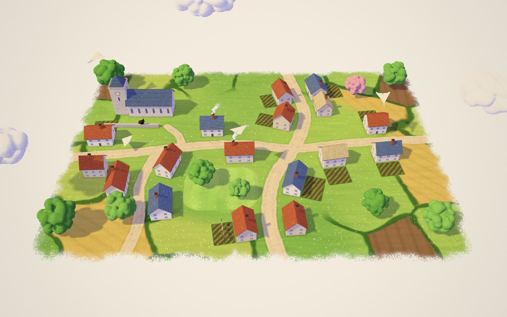

# SKY

**Draw a line in the sky. A little paper plane flies it.**



The fourth piece after [MEADOW](https://github.com/Mariaareadne1/meadow-interactive) (draw a sheep), [POND](https://github.com/Mariaareadne1/pond-interactive) and [HIVE](https://github.com/Mariaareadne1/hive-interactive): a small painted town on a sheet of paper. Draw anywhere over it and a square of cream paper appears at the start of your line, folds itself crease by crease into a dart, and flies your line — banking into turns, looping where your line loops, its shadow skimming the rooftops — then glides on, comes down on whatever is under it and rocks gently in the breeze.

**Live: https://sky-interactive.vercel.app** · [Demo video (20 s)](docs/media/sky-demo-720p.mp4) · [Case study](CASE_STUDY.md) · [Art direction](docs/ART_DIRECTION.md) · [Progress](PROGRESS.md)

## Playing

- **Draw** a line over the town. Draw slowly for a lazy glide, quickly for a zippy swoop. A little curl in your line becomes a loop-the-loop.
- The line stays as a faint ghost and is rubbed out behind the plane as it follows it.
- **Click a plane** (flying or landed) for its size and height, and four things it can do:
  - **Fly again** — it takes off from where it is and flies its line once more.
  - **Loop** — one loop-the-loop right where it is, then on it goes.
  - **Draw its next flight** — your next line becomes this plane's flight.
  - **Remove** — it unfolds back into a flat sheet and drifts away.
- **Drag** a landed plane to set it down somewhere else (a roof, the green, a lane).
- Up to eight planes; a ninth sends the oldest on its way.

| Keys | |
|---|---|
| F · L · N | Fly again · Loop · Draw its next flight |
| Delete | Remove |
| Tab · Esc | Select next plane · Deselect / cancel |
| ⌘Z · ⇧⌘Z | Undo · Redo |
| H | Hide the interface |

The menu (⋯) has Showcase, Record 12-second clip, Hide interface, Export/Import scene and Clear the sky. The camera button saves a PNG of the real WebGL scene; recordings include your drawn line, rubbed out exactly as far as the plane has flown (MP4/H.264 where the browser supports it, else WebM). `?showcase`, `?empty` and `?quality=low` are URL options. Touch and pen work; `prefers-reduced-motion` gives slower, gentler flights with no loops.

## How it works

- **The flight is a pure function of (path, time, seed).** `src/flight/path.ts` projects the stroke onto an invisible, gently curved *flight sheet* over the town (4–9 town metres above the roofs; higher at the back), turns drawing speed into flying speed, finds where the line crosses itself and lifts each little loop into a vertical loop-the-loop. `src/flight/flight.ts` resamples it into an even ribbon (centripetal Catmull–Rom), runs an energy model (dives speed up, climbs slow down), builds rotation-minimising frames — gently righted toward level flight except inside loops, so the plane is upside down at the top — banks from horizontal curvature (tan bank = v²κ/g), then glides on from the end of the line, steering back over the village, lifting over low walls, avoiding tall ones, and touches down on whatever is under it with a slide and a small bounce.
- **The plane is real origami.** `src/plane/fold.ts` folds a 49×49 sheet grid in four steps (corners, nose, keel, wings), each a rotation about a crease of the points on one side of it as the sheet lay before that step. Grid points are snapped exactly onto every crease so folded edges are straight; folds stop a hair short of flat for paper's thickness.
- **The town** (`src/scene/town.ts`) is one data module: lanes, a seeded walk that stands cottages along them, gardens, the church and its clock tower, trees, the churchyard wall and its cat. The ground paint's GLSL twin is generated from the same numbers and baked once into a texture; roofs, walls and windows are painted by a single building shader; trees and clouds are MEADOW's puff fields.
- **Light and shadow** are MEADOW's: a painted two-tone ramp with lavender shade and one sun shadow map with contact-hardening — a plane skimming a roof throws a crisp shadow, a plane high up a softer, fainter one.

Vite + TypeScript + plain Three.js with custom `ShaderMaterial`s; React only for the interface.

## Running

```bash
npm install
npm run dev            # http://localhost:5386
npm test               # 28 unit tests (Vitest)
npm run test:e2e       # 13 real-browser tests (Playwright, Chromium with Metal ANGLE)
E2E_PROD=1 npm run test:e2e   # the same against the production build
npm run typecheck && npm run lint && npm run build
```

QA scripts (need the dev server): `scripts/shoot.mjs` (screenshots), `scripts/flight.mjs` (films a drawn flight, fixed-step, close crops), `scripts/fold.mjs` (the fold-in frame by frame), `scripts/perf.mjs` (GPU-synced benchmark with eight planes in the air), `scripts/demo.mjs` (the scripted demo, recorded by the app's own recorder), `scripts/gallery.mjs` (these images).

MIT © the author.
